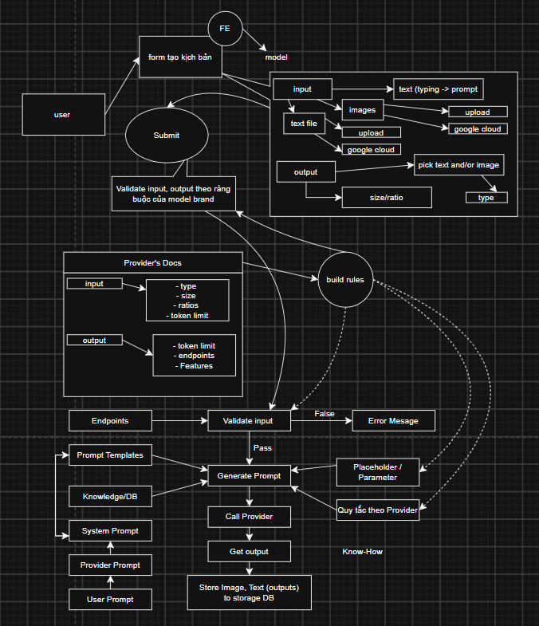

# AI Script Agent - Tạo kịch bản video ngắn bằng LLM và Prompt Engineering

[](../../actions/workflows/tests.yml)


Hệ thống dùng LLM để viết kịch bản video ngắn (TikTok, YouTube Shorts, Reels) sẵn sàng cho sản xuất. Prompt được
xây dựng từ template, kiến thức sản xuất, tham số người dùng và quy tắc rút ra từ tài liệu của từng provider. Kịch
bản sau khi sinh ra được tự chấm điểm và tự sửa cho tới khi đạt chuẩn. Dự án cũng là một benchmark so sánh 6
framework prompt engineering (RICE, TAG, CARE, RACE, RISE, HYBRID) trên nhiều provider (Gemini, OpenAI, Groq).

Xem kết quả một lần chạy thật ở mục [Kết quả chạy thử](#kết-quả-chạy-thử).

## Kiến trúc



Luồng xử lý theo sơ đồ:

- Người dùng điền **form tạo kịch bản** trên FE, chọn model, nhập input (text, text file hoặc hình ảnh, tải lên
  trực tiếp hoặc từ Google Cloud) và chọn kiểu output (text và/hoặc hình ảnh, kích thước, tỉ lệ khung hình).
- Khi bấm **Submit**, input và output được kiểm tra theo ràng buộc của model brand.
- **Provider's Docs** (input: type, size, ratios, token limit; output: token limit, endpoints, features) được dùng để
  **build rules**. Từ các rule này, hệ thống sinh ra bộ validate, placeholder/parameter và quy tắc theo provider.
- Bước **Validate input** kết hợp rule với endpoint của provider. Nếu không hợp lệ thì trả về error message, nếu
  hợp lệ thì chuyển sang **Generate Prompt**.
- **Generate Prompt** nhận thông tin từ 4 luồng: prompt templates, knowledge/DB, placeholder/parameter và quy tắc
  theo provider. Prompt templates được điều chỉnh theo system prompt, còn system prompt được xây dựng từ provider
  prompt và user prompt.
- Prompt hoàn chỉnh được gửi tới provider (**Call Provider**), nhận kết quả (**Get output**), sau đó lưu text và
  hình ảnh vào storage DB.

### Trạng thái triển khai

| Thành phần trong sơ đồ | Trạng thái | Vị trí trong code |
|---|---|---|
| FE, form tạo kịch bản | Chưa làm, hiện dùng CLI thay thế | [cli.py](script_agent/cli.py) |
| Input text | Đã làm | [schemas.py](script_agent/schemas.py) |
| Input text file, images, upload, Google Cloud | Chưa làm | |
| Output: chọn text/image, size/ratio | Chưa làm, hiện chỉ xuất text | |
| Validate input theo ràng buộc model brand | Đã làm (schema, quy tắc nghiệp vụ, giới hạn token) | [validators.py](script_agent/validators.py) |
| Provider's Docs, build rules | Một phần: spec viết tay từ tài liệu provider, chưa tự động build rules | [providers/specs.py](script_agent/providers/specs.py) |
| Endpoints | Một phần: mới ghi nhận trong spec, chưa dùng để validate | [providers/specs.py](script_agent/providers/specs.py) |
| Error message | Đã làm | [validators.py](script_agent/validators.py) |
| Generate Prompt từ 4 luồng | Đã làm (knowledge hiện là dữ liệu tĩnh, quy tắc dùng chung cho mọi provider) | [prompts/](script_agent/prompts/) |
| System prompt, provider prompt, user prompt | Một phần: có một system prompt chung | [prompts/common.py](script_agent/prompts/common.py) |
| Call Provider, Get output | Đã làm (Gemini, OpenAI, Groq, có retry) | [providers/](script_agent/providers/) |
| Store outputs to storage DB | Một phần: lưu file Markdown và JSON trong `outputs/` | [report.py](script_agent/report.py) |

### Phần mở rộng: vòng đánh giá và sửa kịch bản

Trong code, giữa bước Get output và bước lưu kết quả có thêm một vòng lặp kiểm soát chất lượng:

1. Kịch bản được chấm bởi 2 lớp: rule-based (45 điểm) và LLM-as-a-judge (55 điểm).
2. Nếu đạt điểm mục tiêu (mặc định 92%) và đúng thời lượng thì dừng.
3. Nếu chưa đạt, các lỗi được gom thành danh sách ưu tiên và gửi lại cho LLM kèm kịch bản hiện tại để viết bản
   mới.
4. Hết số vòng cho phép thì trả về bản tốt nhất.

Chi tiết thiết kế: [docs/architecture.md](docs/architecture.md).

## Tính năng chính

- **Vòng lặp sinh, đánh giá và sửa**: lỗi cụ thể của từng vòng được đưa ngược lại cho LLM để sửa.
- **Đánh giá kết hợp** trên thang 100 điểm:
  - *Rule-based (45 điểm)*: kiểm tra thời lượng, timeline liên tục, đủ trường, định dạng, tốc độ đọc.
  - *LLM-as-a-judge (55 điểm)*: 8 tiêu chí chất lượng, trả JSON kèm danh sách lỗi và cách sửa cho từng Scene.
- **6 framework prompt** dùng chung các ràng buộc cứng, nhờ vậy việc so sánh cấu trúc prompt được công bằng.
- **Nhiều provider**: Gemini, OpenAI, Groq qua một interface chung, có retry và backoff. Có thể dùng model khác làm
  giám khảo để giảm thiên lệch khi model tự chấm bài của chính mình.
- **Validate trước khi tốn token**: schema đầu vào (Pydantic) và giới hạn token theo spec của từng model.
- **Báo cáo** dạng Markdown và JSON (đầy đủ lịch sử từng vòng), benchmark có bảng tổng hợp.
- **Test offline** dùng fake provider, không cần API key, chạy tự động trên GitHub Actions.

## Kết quả chạy thử

Lần chạy ngày 16/11/2026 với cấu hình:

| Thiết lập | Giá trị |
|---|---|
| Chủ đề | Bạo lực học đường |
| Thời lượng | 1 phút, YouTube Shorts |
| Khán giả | Học sinh THCS và phụ huynh |
| Định hướng | Nhận diện các dạng bạo lực học đường và cách tìm kiếm sự giúp đỡ |
| Framework | RACE |
| Model viết kịch bản | Gemini 3.6 Flash |
| Model giám khảo | Groq gpt-oss-120b |
| Điểm mục tiêu | 92%, tối đa 5 vòng |

```bash
python -m script_agent -v generate --topic "Bạo lực học đường" --duration 1 \
  --platform "YouTube Shorts" --audience "học sinh THCS và phụ huynh" \
  --brief "Nhận diện các dạng bạo lực học đường và cách tìm kiếm sự giúp đỡ" \
  --framework RACE --provider gemini --judge-provider groq
```

### Điểm qua từng vòng

| Vòng | Rule-based (45) | Judge (55) | Tổng | Thời lượng | Tốc độ đọc | Ghi chú |
|---:|---:|---:|---:|---|---|---|
| 1 | 45.0 | 44.7 | 89.7% | 60s/60s | 2,77 âm tiết/giây | dialogue 6/10, pacing 7/10 |
| 2 | 45.0 | 45.4 | 90.4% | 60s/60s | 2,40 âm tiết/giây | dialogue tăng lên 7, pacing tăng lên 8 |
| 3 | 44.8 | 46.1 | **90.9%** | 60s/60s | 2,18 âm tiết/giây | hook tăng lên 9, bản tốt nhất |
| 4 | 42.5 | 44.7 | 87.2% | 60s/60s | 2,42 âm tiết/giây | bị trừ oan 2,5 điểm format, xem nhận xét |
| 5 | - | - | - | - | - | Gemini quá tải (503), hết lượt thử lại |

Tổng thời gian 375 giây, dùng 29.740 token. Kết quả: `best_effort`, trả về bản ở vòng 3.

### Kịch bản tốt nhất (vòng 3)

Nguyên văn output của model:

```text
Scene 1 — 00:00–00:04
Visual/Action:
Cận cảnh chiếc cặp sách bị hất văng xuống sàn hành lang với tiếng va chạm mạnh. Máy quay chuyển nhanh sang ánh mắt sợ hãi, rấn nước mắt của một học sinh. Chữ xuất hiện: BẠO LỰC HỌC ĐƯỜNG - Đừng im lặng!
Dialogue/Narration:
Bạn có chắc con mình, hoặc chính bạn, đang an toàn ở trường?

Scene 2 — 00:04–00:10
Visual/Action:
Khung hình chia đôi: Bên trái học sinh THCS ngồi thu mình nhìn điện thoại im lặng, bên phải người mẹ đứng ngoài cửa thở dài đầy âu lo. Chữ trên màn hình: Dấu hiệu âm thầm.
Dialogue/Narration:
Dấu hiệu bạo lực thường ẩn sau sự im lặng của con và nỗi lo của cha mẹ.

Scene 3 — 00:10–00:20
Visual/Action:
Đoạn 1: Học sinh bị giật mạnh balo và xô ngã. Đoạn 2: Một nhóm bạn chỉ tay thì thầm xúc phạm, nạn nhân cúi gục mặt né tránh. Chữ nổi bật: Thể xác & Lời nói.
Dialogue/Narration:
Đó là bạo lực thể xác như đánh đập, trấn tiền. Hay bạo lực lời nói như lăng mạ, miệt thị.

Scene 4 — 00:20–00:32
Visual/Action:
Màn hình điện thoại liên tục nổ tin nhắn miệt thị trong nhóm chat, chuyển cảnh học sinh ngồi một mình ở góc sân trường vắng lặng. Chữ xuất hiện: Bạo lực mạng & Cô lập.
Dialogue/Narration:
Bạo lực mạng với tin đồn lan truyền 24/7, cùng hành vi cô lập, tẩy chay khiến nạn nhân hoàn toàn đơn độc.

Scene 5 — 00:32–00:44
Visual/Action:
Chuỗi hình ảnh nhanh: Học sinh kéo chăn trùm đầu sợ hãi khi chuông báo thức reo, đẩy bỏ bát cơm đầy, ngồi thu mình ở góc phòng từ chối nói chuyện. Người mẹ nhẹ nhàng đến bên nắm lấy tay con. Chữ: Nhận diện thay đổi.
Dialogue/Narration:
Khi trẻ sợ đi học, bỏ ăn hay thu mình lại, đó là lúc con đang rất cần được bảo vệ.

Scene 6 — 00:44–01:00
Visual/Action:
Học sinh mỉm cười tự tin khi trải lòng với cô giáo tư vấn. Đồ họa số điện thoại 111 xuất hiện to, rõ cùng biểu tượng Thích và Chia sẻ nhấp nháy trên giao diện YouTube Shorts. Chữ: Tổng đài 111 — Chung tay bảo vệ con trẻ!
Dialogue/Narration:
Đừng chịu đựng một mình. Hãy chia sẻ với thầy cô, cha mẹ hoặc gọi ngay Tổng đài 111. Nhấn Thích và Chia sẻ video này vì một môi trường học đường an toàn!
```

Báo cáo đầy đủ: [examples/race_gemini-groq_bao-luc-hoc-duong_1min.md](examples/race_gemini-groq_bao-luc-hoc-duong_1min.md).
Toàn bộ prompt, output và nhận xét của judge từng vòng:
[examples/race_gemini-groq_bao-luc-hoc-duong_1min.json](examples/race_gemini-groq_bao-luc-hoc-duong_1min.json).

### Nhận xét

- **Thời lượng chính xác ngay từ vòng đầu.** Cả 4 vòng đều kết thúc đúng tại 01:00, timeline liên tục, đủ trường
  cho mọi cảnh. Việc ghi rõ mốc kết thúc và số âm tiết trong prompt phát huy tác dụng.
- **Vòng sửa có cải thiện thật.** Từ vòng 1 đến vòng 3, điểm judge tăng từ 44,7 lên 46,1. Hook được làm mạnh hơn
  (cặp sách bị hất văng, tiếng va chạm), CTA có thêm tổng đài 111, đúng với góp ý của judge.
- **Điểm dừng ở khoảng 90-91%, chưa đạt 92%.** Hai tiêu chí dialogue và pacing dừng ở 7/10. Judge liên tục góp ý
  câu dẫn quá dài, trong khi rule-based ở vòng 3 lại nhắc thêm lời dẫn (2,18 âm tiết/giây, ngay dưới ngưỡng 2,2).
  Hai tín hiệu ngược chiều này là điểm cần tinh chỉnh tiếp, ví dụ hạ ngưỡng tốc độ đọc tối thiểu hoặc yêu cầu judge
  góp ý theo hướng "nhiều câu ngắn" thay vì "ít chữ hơn".
- **Phát hiện và sửa một lỗi của parser.** Ở vòng 4, Gemini ghi "Cảnh 1: ..." trong phần Visual/Action để mô tả
  cú máy phụ, parser cũ hiểu nhầm là tiêu đề cảnh thiếu timestamp và trừ 2,5 điểm format. Lỗi đã được sửa và có
  test hồi quy. Chấm lại theo parser mới, vòng 4 đạt 45/45 điểm rule-based (tổng 89,7%), bản tốt nhất vẫn là vòng 3.
- **Gemini quá tải.** Model trả lỗi 503 nhiều lần, vòng 5 thất bại sau 3 lần thử. Số lần thử lại đã được tăng lên 5,
  thời gian chờ tăng dần có ngẫu nhiên. Nhờ cơ chế giữ bản tốt nhất, lần chạy vẫn trả về kết quả dùng được.
- **Judge chưa bắt lỗi chính tả.** Cụm "rấn nước mắt" (đúng ra là "rơm rớm nước mắt") lọt qua cả 4 vòng chấm. Có thể
  bổ sung tiêu chí chính tả cho judge hoặc một bước kiểm tra chính tả riêng.

## Cài đặt

```bash
git clone https://github.com/MrBread-21/Script-AI-Agent.git
cd Script-AI-Agent
python -m venv .venv && source .venv/bin/activate   # Windows: .venv\Scripts\activate
pip install -r requirements.txt
cp .env.example .env                                 # sau đó điền API key
```

Chỉ cần key của provider bạn dùng (`GEMINI_API_KEY`, `OPENAI_API_KEY`, `GROQ_API_KEY`).

## Sử dụng

### Tạo một kịch bản

```bash
python -m script_agent generate \
  --topic "Bạo lực học đường" \
  --duration 1 \
  --platform "YouTube Shorts" \
  --audience "học sinh THCS" \
  --brief "Nhận diện các dạng bạo lực và cách tìm sự giúp đỡ" \
  --framework RACE \
  --provider gemini
```

Kết quả được in ra màn hình và lưu vào `outputs/` (file `.md` để đọc và file `.json` chứa đầy đủ lịch sử).

Các tham số hữu ích:

| Tham số | Ý nghĩa |
|---|---|
| `--duration 0.5` | Thời lượng tính bằng phút, từ 0.25 đến 5 (tức 15 giây đến 5 phút) |
| `--framework RACE TAG` hoặc `ALL` | Chạy một, nhiều hoặc tất cả framework |
| `--provider groq --model <id>` | Đổi provider hoặc model |
| `--judge-provider openai` | Dùng LLM khác làm giám khảo |
| `--max-iterations 3 --target 90` | Số vòng tối đa và điểm mục tiêu |
| `--no-system-prompt` | Tắt system prompt để thử nghiệm |
| `-v` | Log chi tiết, bao gồm danh sách lỗi mỗi vòng |

### Xem prompt mà không gọi API

```bash
python -m script_agent prompt --topic "AI là gì" --duration 0.5 --framework RISE --system
```

### Benchmark các framework

```bash
python -m script_agent benchmark --provider gemini --frameworks ALL --max-iterations 3
python -m script_agent benchmark --ids TC006 TC007 --frameworks RACE RISE --judge-provider groq
```

Test case nằm trong [data/test_cases.json](data/test_cases.json). Kết quả được lưu vào `outputs/benchmark_*.md` và
`outputs/benchmark_*.json`, gồm điểm trung bình, tỉ lệ đạt, tỉ lệ đúng thời lượng, số vòng, độ trễ và token.

### Dùng như thư viện

```python
from dotenv import load_dotenv
from script_agent import run_driver
from script_agent.providers import get_provider

load_dotenv()
result = run_driver(
    {"topic": "Mẹo học tiếng Anh",
     "metadata": {"platform": "TikTok", "audience": "học sinh", "duration": 0.5}},
    framework="HYBRID",
    provider=get_provider("gemini"),
    judge_provider=get_provider("groq"),
)
print(result["status"], result["percentage"])
print(result["script"])
```

## Các framework prompt

| Framework | Cấu trúc | Đặc điểm |
|---|---|---|
| **RICE** | Role, Input, Context, Example | Có ví dụ mẫu (few-shot) |
| **TAG** | Task, Action, Goal | Ngắn gọn, hướng mục tiêu |
| **CARE** | Context, Action, Result, Example | Nhấn mạnh bối cảnh hệ thống |
| **RACE** | Role, Action, Context, Execute | Danh sách bước thực thi rõ ràng |
| **RISE** | Role, Input, Steps, Expectation | Quy trình suy nghĩ nội bộ từng bước |
| **HYBRID** | Role, Context, Input, Steps, Constraints, Example | Kết hợp điểm mạnh của các framework trên |

Mọi framework dùng chung các khối: quy tắc ngôn ngữ, quy tắc thời lượng (mốc kết thúc chính xác, số âm tiết mục
tiêu) và định dạng đầu ra. Xem [script_agent/prompts/common.py](script_agent/prompts/common.py).

## Thang điểm

**Rule-based - 45 điểm** ([rule_based.py](script_agent/evaluators/rule_based.py))

| Kiểm tra | Điểm | Mô tả |
|---|---:|---|
| duration | 15 | Cảnh cuối kết thúc đúng thời lượng yêu cầu |
| timeline | 5 | Bắt đầu tại 00:00, giữa các cảnh không bị hở hay chồng lấn |
| completeness | 10 | Mọi cảnh có cả Visual/Action và Dialogue/Narration |
| format | 5 | Tiêu đề cảnh có số thứ tự và mốc thời gian đọc được, tối thiểu 3 cảnh |
| speech_rate | 10 | Lời dẫn từ 2,2 đến 3,6 âm tiết mỗi giây (tốc độ đọc tự nhiên tiếng Việt) |

**LLM judge - 55 điểm** ([llm_judge.py](script_agent/evaluators/llm_judge.py)): `topic_relevance`,
`audience_fit`, `structure`, `pacing`, `dialogue`, `hook`, `CTA`, `coherence`. Mỗi tiêu chí chấm từ 1 đến 10, chạy
với temperature 0.

Kịch bản **đạt** khi tổng điểm không thấp hơn `--target` và thời lượng chính xác. Nếu hết số vòng mà chưa đạt, hệ
thống trả về phiên bản tốt nhất, ưu tiên bản đúng thời lượng trước rồi mới xét điểm.

## Cấu trúc thư mục

```text
script_agent/
├── cli.py               # CLI: generate, benchmark, prompt
├── driver.py            # Vòng lặp sinh, đánh giá và sửa
├── generator.py         # Dựng prompt, validate, gọi LLM, làm sạch output
├── schemas.py           # Pydantic schema đầu vào
├── validators.py        # Validate input và giới hạn token theo model
├── config.py            # Tham số mặc định (target, tốc độ đọc, knowledge...)
├── benchmark.py         # Chạy và tổng hợp benchmark
├── report.py            # Xuất Markdown, JSON
├── prompts/             # common.py, frameworks.py, judge.py
├── evaluators/          # rule_based.py, llm_judge.py, feedback.py
└── providers/           # base.py, gemini, openai, groq, specs.py
data/test_cases.json     # Bộ test case benchmark
docs/                    # Sơ đồ và tài liệu kiến trúc
examples/                # Output mẫu
tests/                   # Pytest, chạy offline với FakeProvider
```

## Phát triển

```bash
pip install -r requirements-dev.txt
pytest -q          # chạy offline, không cần API key
ruff check .
```

**Thêm provider mới**: tạo class kế thừa `BaseProvider`, cài đặt hàm `_call()`, đăng ký trong
[providers/\_\_init\_\_.py](script_agent/providers/__init__.py) và (tuỳ chọn) thêm spec trong
[providers/specs.py](script_agent/providers/specs.py).

**Thêm framework mới**: thêm template vào `FRAMEWORK_PROMPTS` trong
[prompts/frameworks.py](script_agent/prompts/frameworks.py). Test sẽ tự kiểm tra các placeholder.

## Hướng phát triển

Các bước tiếp theo để hoàn thiện theo sơ đồ kiến trúc:

- FE với form tạo kịch bản, cho phép chọn model và kiểu output.
- Hỗ trợ input dạng text file và hình ảnh (upload trực tiếp hoặc từ Google Cloud).
- Tự động build rules từ Provider's Docs, sinh validate, placeholder và quy tắc riêng cho từng provider.
- Dùng endpoints của provider trong bước validate input.
- System prompt riêng cho từng provider, ghép từ provider prompt và user prompt.
- Knowledge/DB thật (RAG) thay cho `DEFAULT_KNOWLEDGE` tĩnh.
- Lưu text và hình ảnh đầu ra vào storage DB.
