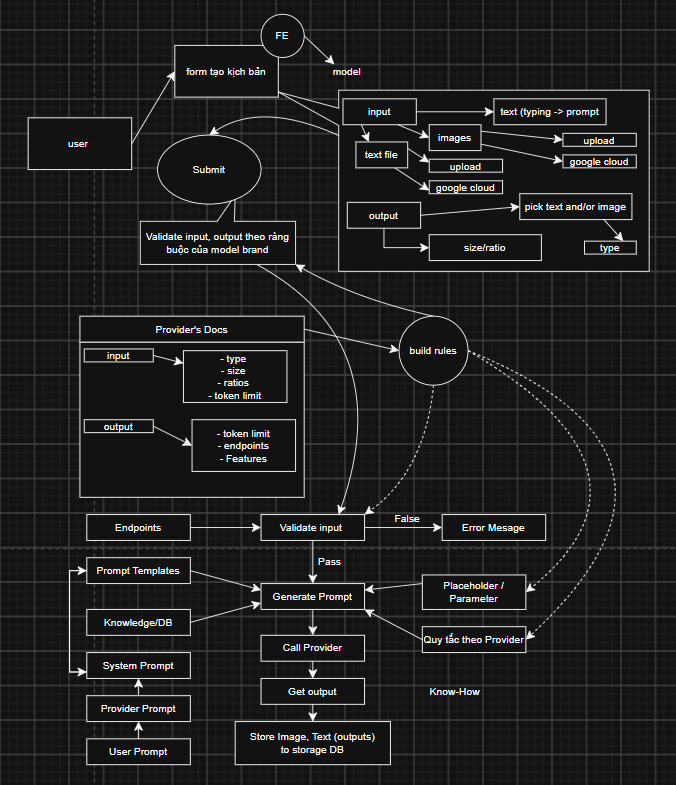

# Kiến trúc và quyết định thiết kế

Bảng đối chiếu giữa sơ đồ và code nằm trong [README](../README.md#trạng-thái-triển-khai). Tài liệu này mô tả phần
backend đã được triển khai.

## Luồng xử lý trong code

1. **Input**: người dùng cung cấp chủ đề, thời lượng, nền tảng, khán giả và (tuỳ chọn) định hướng nội dung, nhân
   vật, ý tưởng cảnh.
2. **Validate input** (`validators.validate_input`): kiểm tra bằng Pydantic schema và quy tắc nghiệp vụ (thời lượng
   từ 15 giây đến 5 phút, số giây là số nguyên, không để trống). Nếu sai thì trả lỗi ngay, không tốn token.
3. **Build context** (`prompts.common.build_context`): chuẩn hoá thành các placeholder dùng chung gồm thời lượng
   dạng chữ, mốc kết thúc `MM:SS`, khoảng số âm tiết mục tiêu, kiến thức sản xuất và ghi chú người dùng.
4. **Generate Prompt**: ghép 4 luồng thông tin theo sơ đồ:
   - placeholder và tham số (từ bước 3),
   - quy tắc theo provider (system prompt, định dạng, thời lượng),
   - prompt template của framework (RICE, TAG, CARE, RACE, RISE, HYBRID),
   - knowledge (hiện là `config.DEFAULT_KNOWLEDGE`, có thể thay bằng DB hoặc RAG).
5. **Validate theo provider** (`validators.validate_request`): ước lượng số token của prompt và kiểm tra
   `max_output_tokens` dựa trên spec của model trong `providers/specs.py` (lấy từ tài liệu của provider).
6. **Call Provider và Get output**: gọi LLM qua `BaseProvider.generate`, tự thử lại với thời gian chờ tăng dần khi
   gặp lỗi tạm thời (429, 5xx). Output được làm sạch bằng cách bỏ code fence và câu dẫn trước cảnh đầu tiên.
7. **Evaluate**: chấm bằng rule-based (45 điểm) và LLM judge (55 điểm).
8. **Feedback**: gom lỗi theo thứ tự ưu tiên, bắt đầu từ các ràng buộc cứng, tiếp theo là nhận xét của judge, cuối
   cùng là các tiêu chí dưới 8/10.
9. **Revise**: prompt sửa chứa yêu cầu gốc, kịch bản hiện tại, điểm số và danh sách lỗi đánh số.
10. **Dừng** khi đạt điểm mục tiêu và đúng thời lượng, hoặc khi hết `max_iterations` (trả về bản tốt nhất).
11. **Lưu kết quả** dạng Markdown và JSON vào `outputs/`.

## Các quyết định đáng chú ý

**Ràng buộc cứng dùng chung giữa các framework.** Nếu chỉ một số framework được nói rõ "kết thúc tại 01:00",
benchmark sẽ đo nội dung ràng buộc chứ không phải cấu trúc prompt. Vì vậy các khối ngôn ngữ, thời lượng và định
dạng được tách vào `prompts/common.py` và chèn vào mọi framework.

**Nói rõ mốc kết thúc và số âm tiết.** LLM tính thời gian kém. Cụm "1 phút" dễ bị hiểu sai, trong khi "kết thúc
tại 01:00 (60 giây), khoảng 132 đến 216 âm tiết" cụ thể hơn nhiều. Tiếng Việt là ngôn ngữ đơn âm tiết nên đếm theo
khoảng trắng gần như bằng đếm âm tiết, nhờ đó có thể kiểm tra tốc độ đọc một cách xác định.

**Evaluator chấp nhận markdown.** Model thường trả về `**Visual/Action:**` hoặc `### Scene 1` dù đã bị yêu cầu
không dùng markdown. Parser chấp nhận các biến thể này để không phạt nhầm nội dung tốt chỉ vì định dạng.

**Judge trả JSON có danh sách lỗi.** Điểm số đơn thuần như "hook 6/10" không cho LLM biết phải sửa gì. Judge được
yêu cầu chỉ rõ Scene nào, lỗi gì và cách sửa. Parser vẫn có phương án dự phòng cho dạng `key: N`.

**Judge có thể tách khỏi generator.** Mặc định dùng chung provider cho tiện, nhưng `--judge-provider` cho phép
dùng model khác để tránh thiên lệch khi tự đánh giá. Judge chạy ở temperature 0 để điểm ổn định hơn.

**Lỗi judge không làm hỏng vòng lặp.** Nếu judge lỗi, vòng đó chỉ chấm bằng rule-based (thang 45 điểm) thay vì
dừng toàn bộ.

**Validate trước khi gọi API.** Lỗi đầu vào và vượt giới hạn token được phát hiện trước khi tốn token.
